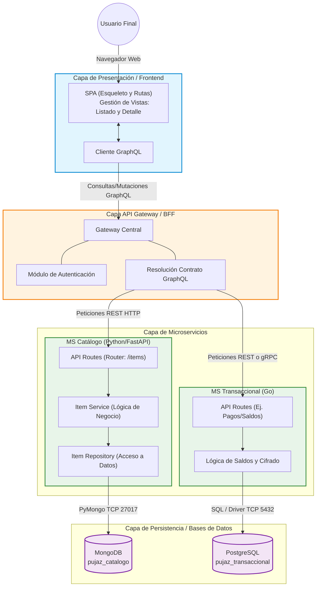

# Arquitectura Actual del Sistema Pujaz

Este documento ilustra la arquitectura general del sistema hasta el día de hoy, basándonos en los avances de todo el equipo (SPA, API Gateway, Microservicios y Bases de Datos).

> **Nota:** Puedes visualizar este diagrama gráficamente si subes este archivo a GitHub (que soporta Mermaid nativamente) o usando una extensión de previsualización de Markdown en tu editor de código (como VS Code).

## Descripción de Componentes

1. **Cliente / Frontend (Trabajo de Catalina):** El usuario interactúa con la SPA. Las vistas de "Listado" y "Detalle" piden datos usando el Cliente GraphQL.
2. **API Gateway (Trabajo de David):** Actúa como el portero del sistema. Recibe la petición GraphQL, verifica la autenticación y decide a qué microservicio(s) debe consultar (REST) para armar la respuesta final.
3. **MS Catálogo (Tu trabajo actual - Python/FastAPI):** Está estructurado en 3 capas internas:
    * **Router:** Expone los endpoints REST (`GET /items`, `POST /items`).
    * **Service:** Transforma los datos.
    * **Repository:** Escribe y lee en MongoDB.
4. **MS Transaccional (Trabajo de Frank - Go):** Manejará información sensible, saldos reservados y cifrado.
5. **Bases de Datos:** Separadas por microservicio siguiendo el patrón *Database-per-service* (MongoDB para catálogo, Postgres para transacciones). Todo orquestado por `docker-compose`.
