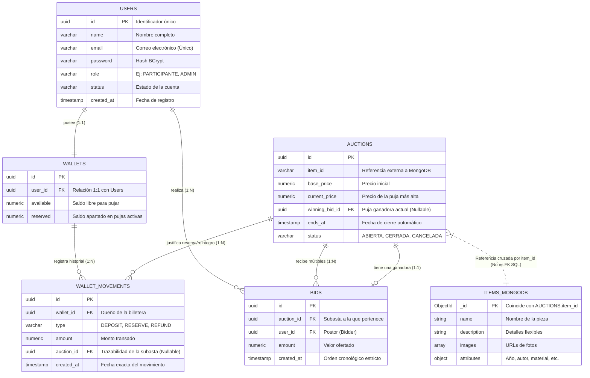

# Modelo de Datos y Arquitectura de Persistencia - Pujaz

**Pujaz** es una plataforma de subastas en tiempo real diseñada bajo una arquitectura SOFEA (Service-Oriented Front-End Architecture). Para garantizar un rendimiento óptimo y una consistencia estricta, el sistema implementa un patrón de Persistencia Políglota (Database per Service), dividiendo la responsabilidad de los datos en dos motores especializados:

1. **PostgreSQL (Microservicio Transaccional):** Motor relacional (SQL) que garantiza consistencia ACID. Gestiona el núcleo crítico del negocio: usuarios, billeteras virtuales, reservas atómicas de saldo, historial inmutable de movimientos y las pujas.
2. **MongoDB (Microservicio de Catálogo):** Motor NoSQL que ofrece flexibilidad de esquema. Ideal para gestionar el catálogo de piezas y artículos, donde cada objeto (arte, vehículos, joyas) posee atributos y características técnicas muy diferentes.

---

## Diagrama Entidad-Relación (ER)

El siguiente diagrama ilustra la estructura relacional dentro de PostgreSQL y su referencia cruzada (identificador externo) hacia la colección de documentos en MongoDB.

