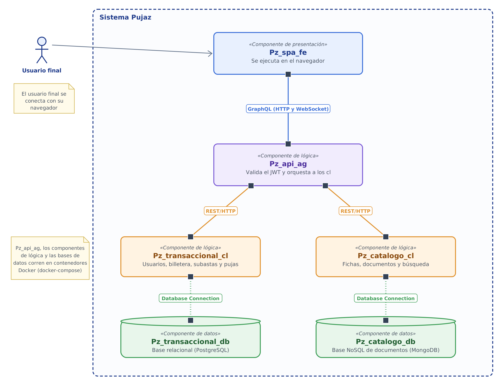

# Vista de componentes y conectores (C&C) · Pujaz

Esta es la vista entregada en la primera entrega ([p1_1c.md](../p1_1c.md), versión `v1.0-entrega1`). El diagrama editable está en [vista-cc.drawio](vista-cc.drawio).

La vista muestra los elementos del sistema que tienen presencia en tiempo de ejecución: los componentes, que son los elementos de cómputo y de almacenamiento de datos, y los conectores, que son los caminos de interacción entre ellos. Tiene seis componentes: la SPA, que corre en el navegador del usuario, y cinco componentes que corren en contenedores. Para nombrarlos usamos la convención `Pz_nombre_categoría`, de modo que el nombre indique la función del componente; la categoría puede ser `fe` (front-end), `ag` (API gateway), `cl` (componente de lógica) o `db` (base de datos).

Cada componente se comunica con los demás a través de sus puertos, que son los cuadros pequeños en su borde. En cada conector, un componente cumple el rol de cliente y el otro el de servidor. Cada attachment une el puerto de un componente con su rol en el conector.

El navegador descarga la SPA desde un contenedor con un servidor web estático (Nginx), que también reenvía las peticiones de `/graphql` al gateway sin modificarlas. Por eso, en la vista, ese servidor se trata como parte del conector GraphQL y no como un componente aparte. Es la razón por la que docker-compose levanta seis contenedores y la vista muestra cinco componentes en contenedores.

Usamos tres tipos de conectores:

1. GraphQL, entre la SPA y el gateway. Funciona de dos formas sobre la misma ruta `/graphql`: las consultas y mutaciones van por HTTP, y la suscripción para el tiempo real va por WebSocket.
2. REST sobre HTTP, entre el gateway y cada componente de lógica.
3. Database Connection, entre cada componente de lógica y su base de datos.

## Elementos y relaciones

### Componentes

| Componente | Tipo | Tecnología | Responsabilidad | Puerto |
|---|---|---|---|---|
| Pz_spa_fe | Presentación | TypeScript, React | Pantallas de listado, detalle, subasta en vivo, inicio de sesión, perfil y billetera. Corre en el navegador. | — |
| Pz_api_ag | Lógica (API gateway) | TypeScript, Node.js, GraphQL | Expone el contrato GraphQL, valida el JWT, llama a los componentes de lógica, junta sus respuestas y envía las actualizaciones de las subastas. | 4000 |
| Pz_transaccional_cl | Lógica | Go | Usuarios y credenciales, billetera, subastas y pujas, con transacciones ACID. | 8080 |
| Pz_catalogo_cl | Lógica | Python, FastAPI | Fichas de las piezas, fotos, documentos, búsqueda y creación de piezas. | 8000 |
| Pz_transaccional_db | Datos (relacional) | PostgreSQL | Usuarios, subastas, pujas y movimientos de la billetera. | 5432 |
| Pz_catalogo_db | Datos (NoSQL) | MongoDB | Fichas del catálogo. | 27017 |

### Conectores

| Conector | Entre | Puerto | Uso |
|---|---|---|---|
| GraphQL | Pz_spa_fe y Pz_api_ag | 4000 | Consultas y mutaciones de cada pantalla, y la suscripción con la que el gateway avisa el nuevo precio cada vez que acepta una puja. |
| REST sobre HTTP | Pz_api_ag y Pz_transaccional_cl | 8080 | Inicio de sesión, usuarios, billetera, subastas y pujas. |
| REST sobre HTTP | Pz_api_ag y Pz_catalogo_cl | 8000 | Listado, búsqueda, detalle y creación de piezas. |
| Database Connection | Pz_transaccional_cl y Pz_transaccional_db | 5432 | Leer y escribir los datos transaccionales. |
| Database Connection | Pz_catalogo_cl y Pz_catalogo_db | 27017 | Leer y escribir las fichas. |

### Attachments

| Conector | Cliente | Servidor |
|---|---|---|
| GraphQL | Pz_spa_fe | Pz_api_ag |
| REST sobre HTTP | Pz_api_ag | Pz_transaccional_cl |
| REST sobre HTTP | Pz_api_ag | Pz_catalogo_cl |
| Database Connection | Pz_transaccional_cl | Pz_transaccional_db |
| Database Connection | Pz_catalogo_cl | Pz_catalogo_db |

### Relaciones

- La SPA solo se comunica con el gateway. Los componentes de lógica y las bases de datos no son visibles para ella.
- El gateway es el único componente que conoce a los dos componentes de lógica. Por ejemplo, para mostrar el listado le pide las fichas a Pz_catalogo_cl y el estado de las subastas a Pz_transaccional_cl, y le devuelve a la SPA una sola respuesta.
- No hay ningún conector entre Pz_transaccional_cl y Pz_catalogo_cl, ni entre un componente de lógica y la base de datos del otro.
- Cuando Pz_transaccional_cl acepta una puja, el gateway completa la información con Pz_catalogo_cl y la envía a todos los usuarios que están viendo esa subasta.
