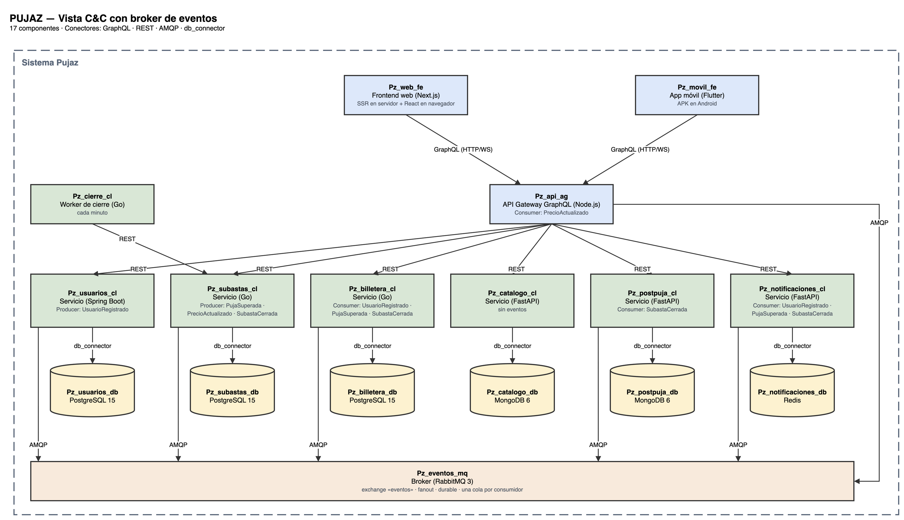

# Vista C&C con broker de eventos · Pujaz

Esta vista muestra los **17 componentes** de Pujaz en tiempo de ejecución y los conectores entre ellos, con el broker de eventos `Pz_eventos_mq` (RabbitMQ) como bus asíncrono en la base del diagrama.

Se considera componente cada pieza de software del sistema que se ejecuta como proceso independiente, sin importar dónde corra. Por eso `Pz_movil_fe`, que corre en Android y no en un contenedor, es un componente igual que los demás.

La línea punteada **Sistema Pujaz** es la frontera del sistema: todo lo que está dentro forma parte de Pujaz.

El proxy inverso `pz-web-proxy` (Nginx) no se incluye. No es una pieza de software del sistema, sino infraestructura configurada que solo reenvía peticiones, sin lógica propia. Por eso los conectores de presentación se dibujan directamente hacia `Pz_api_ag`. El proxy aparece en la [vista de despliegue](../despliegue/vista-despliegue-dasayo.md).

*El diagrama editable está en [vista-cc-broker.drawio](vista-cc-broker.drawio).*

## Organización del diagrama

El diagrama se lee de arriba abajo, por capas:

1. **Presentación:** `Pz_web_fe` y `Pz_movil_fe`.
2. **Gateway:** `Pz_api_ag`. A la izquierda está `Pz_cierre_cl`, que no recibe peticiones; las inicia.
3. **Servicios de lógica:** los seis microservicios. Cada uno indica si es *Producer* o *Consumer* de eventos.
4. **Datos:** la base de datos de cada servicio, justo debajo de él (Database per Service).
5. **Broker:** `Pz_eventos_mq`, como bus al que se conectan todos los productores y consumidores.

Colores: azul para presentación y Gateway, verde para lógica, amarillo para datos y naranja para el broker.

## Componentes

| Componente | Capa | Tecnología | Responsabilidad | Eventos |
|---|---|---|---|---|
| `Pz_web_fe` | Presentación | TypeScript (Next.js) | Aplicación web: listado, detalle, pujas, perfil y billetera. Renderiza en el servidor (SSR) y continúa en el navegador con React. | — |
| `Pz_movil_fe` | Presentación | Dart (Flutter), APK en Android | App móvil: login, catálogo, detalle, pujas y precio en vivo. | — |
| `Pz_api_ag` | Gateway | Node.js 22 (TypeScript) | API GraphQL única. Valida JWT, orquesta los servicios por REST y envía el precio en vivo por WebSocket. | Consumer: `PrecioActualizado` |
| `Pz_cierre_cl` | Lógica (worker) | Go | Cada minuto pide a `Pz_subastas_cl` que cierre las subastas vencidas. No tiene base de datos ni servidor HTTP. | — |
| `Pz_usuarios_cl` | Lógica | Java (Spring Boot) | Registro, inicio de sesión, perfil y roles. | Producer: `UsuarioRegistrado` |
| `Pz_subastas_cl` | Lógica | Go | Publicación de subastas, validación de pujas y cierre. | Producer: `PujaSuperada`, `PrecioActualizado`, `SubastaCerrada` |
| `Pz_billetera_cl` | Lógica | Go | Saldos, reservas, reintegros y cobro al ganador. | Consumer: `UsuarioRegistrado`, `PujaSuperada`, `SubastaCerrada` |
| `Pz_catalogo_cl` | Lógica | Python (FastAPI) | Piezas, fichas, fotos y búsqueda. | — |
| `Pz_postpuja_cl` | Lógica | Python (FastAPI) | Entrega de la pieza ganada y seguimiento. | Consumer: `SubastaCerrada` |
| `Pz_notificaciones_cl` | Lógica | Python (FastAPI) | Avisos por usuario y su consulta por REST. | Consumer: `UsuarioRegistrado`, `PujaSuperada`, `SubastaCerrada` |
| `Pz_eventos_mq` | Broker | RabbitMQ 3 | Recibe los eventos en el exchange `eventos` y los copia a la cola de cada consumidor. | — |
| `Pz_usuarios_db` | Datos | PostgreSQL 15 | Usuarios y credenciales. | — |
| `Pz_subastas_db` | Datos | PostgreSQL 15 | Subastas y pujas. | — |
| `Pz_billetera_db` | Datos | PostgreSQL 15 | Billeteras y movimientos. | — |
| `Pz_catalogo_db` | Datos | MongoDB 6 | Piezas y archivos. | — |
| `Pz_postpuja_db` | Datos | MongoDB 6 | Entregas y su estado. | — |
| `Pz_notificaciones_db` | Datos | Redis | Lista de notificaciones de cada usuario. | — |

*`Pz_spa_fe` existe en el repositorio, pero no forma parte del `docker-compose.yml` actual, por lo que no se incluye.*

## Conectores

| Conector | Origen | Destino | Descripción |
|---|---|---|---|
| **GraphQL (HTTP/WS)** | `Pz_web_fe` | `Pz_api_ag` | Queries y mutations por HTTP, tanto desde el servidor al renderizar como desde el navegador. El precio en vivo llega por WebSocket. |
| **GraphQL (HTTP/WS)** | `Pz_movil_fe` | `Pz_api_ag` | La app hace queries y mutations por HTTP y recibe el precio en vivo por WebSocket. |
| **REST** | `Pz_api_ag` | Los seis servicios de lógica | Orquestación síncrona: el Gateway delega cada operación en el servicio que la resuelve. |
| **REST** | `Pz_cierre_cl` | `Pz_subastas_cl` | Petición periódica para cerrar subastas vencidas. Ese cierre es el que publica `SubastaCerrada`. |
| **db_connector** | Cada servicio de lógica | Su propia base de datos | Conexión exclusiva del servicio con su base (Database per Service). |
| **AMQP** | Productores y consumidores | `Pz_eventos_mq` | Publicación y consumo asíncrono de eventos. La flecha va hacia el broker porque cada servicio abre su propia conexión. |

## Cómo funciona el broker

1. Todos los servicios declaran el mismo exchange `eventos`, de tipo **fanout** y durable.
2. El productor publica cada evento en ese exchange y pone el nombre del evento en la **routing key** (por ejemplo, `SubastaCerrada`).
3. Como el exchange es fanout, RabbitMQ entrega una copia del mensaje a **todas** las colas enlazadas, sin mirar la routing key.
4. Cada consumidor tiene su propia cola. Lee la routing key de cada mensaje y procesa solo los eventos que le interesan.
5. Si un consumidor está caído, los mensajes esperan en su cola durable y se procesan cuando vuelve. La excepción es `Pz_api_ag`, cuya cola es temporal.

| Evento | Publicado por | Consumido por | Efecto |
|---|---|---|---|
| `UsuarioRegistrado` | `Pz_usuarios_cl` | `Pz_billetera_cl`, `Pz_notificaciones_cl` | Crea la billetera y envía la bienvenida. |
| `PujaSuperada` | `Pz_subastas_cl` | `Pz_billetera_cl`, `Pz_notificaciones_cl` | Reintegra la reserva al postor superado y le avisa. |
| `PrecioActualizado` | `Pz_subastas_cl` | `Pz_api_ag` | Envía el precio nuevo por WebSocket a quienes ven la subasta. |
| `SubastaCerrada` | `Pz_subastas_cl` | `Pz_billetera_cl`, `Pz_postpuja_cl`, `Pz_notificaciones_cl` | Cobra al ganador, registra la entrega y avisa a ganador y participantes. |

| Consumidor | Cola | Tipo de cola |
|---|---|---|
| `Pz_api_ag` | Nombre generado por RabbitMQ | Exclusiva y temporal: se borra cuando el Gateway se desconecta. |
| `Pz_billetera_cl` | `billetera_eventos` | Durable |
| `Pz_postpuja_cl` | `postpuja.eventos` | Durable |
| `Pz_notificaciones_cl` | `pujaz.notificaciones` | Durable |
