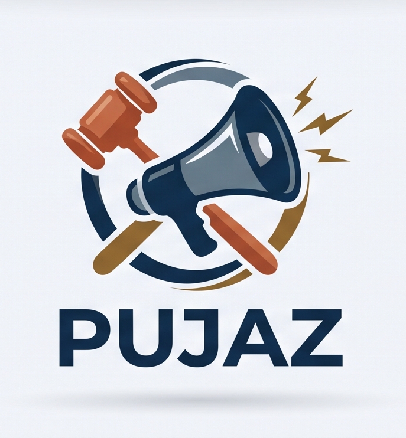

# Prototipo 1: Estructura arquitectónica simple

## 1. Equipo

Nombre del equipo: 1C

Integrantes:

- María Catalina Rodríguez Cardona
- David Alejandro Sepúlveda Amaya
- Heider Hailober Navarro Quintero
- Frank Kenner Olmos Prada
- Yeiner Arwawingumu Zapata Vallejo
- Adrián Alberto Diosa Benavides

## 2. Sistema

Nombre: Pujaz

<p align="center"></p>

### Descripción del prototipo (alcance actual)

Pujaz es una plataforma web para una casa de subastas estructurada como un Producto Mínimo Viable (MVP). Cualquier usuario registrado en el sistema puede explorar el catálogo y publicar nuevas piezas. Cada pieza tiene una ficha con fotos, descripción, una etiqueta de categoría y precio base.

Toda pieza está asociada a una subasta con una hora de cierre definida (por defecto, 14 días si no se especifica). Los usuarios pueden pujar y ver en tiempo real cómo cambia el precio y quién va ganando, sin necesidad de recargar la página.

Para garantizar la seriedad de las ofertas, cada usuario tiene una billetera virtual (recargable mediante códigos promocionales) dividida en dos saldos: disponible y reservado. Al realizar una puja, el sistema valida que existan fondos suficientes; si la puja es aceptada, el monto ofrecido se transfiere del saldo disponible al reservado. Si otra persona supera esa oferta, el dinero reservado del postor anterior se le reintegra automáticamente a su saldo disponible, permitiéndole volver a pujar. Todos estos movimientos de la billetera (recargas, retenciones y reintegros) quedan registrados en un historial.

*Nota técnica del MVP:* durante el cierre de la subasta, el saldo del ganador final permanece en estado «reservado» como garantía; el proceso de liquidación final o cobro comercial queda fuera del alcance de este prototipo.

## 3. Estructuras arquitectónicas

### 3.1 Vista de componentes y conectores


La vista muestra los elementos del sistema que tienen presencia en tiempo de ejecución: los componentes, que son los elementos de cómputo y de almacenamiento de datos, y los conectores, que son los caminos de interacción entre ellos. Tiene seis componentes: la SPA, que corre en el navegador del usuario, y cinco componentes que corren en contenedores. Para nombrarlos usamos la convención `Pz_nombre_categoría`, de modo que el nombre indique la función del componente; la categoría puede ser `fe` (front-end), `ag` (API gateway), `cl` (componente de lógica) o `db` (base de datos).

Cada componente se comunica con los demás a través de sus puertos, que son los cuadros pequeños en su borde. En cada conector, un componente cumple el rol de cliente y el otro el de servidor. Cada attachment une el puerto de un componente con su rol en el conector.

El navegador descarga la SPA desde un contenedor con un servidor web estático (Nginx), que también reenvía las peticiones de `/graphql` al gateway sin modificarlas. Por eso, en la vista, ese servidor se trata como parte del conector GraphQL y no como un componente aparte. Es la razón por la que docker-compose levanta seis contenedores y la vista muestra cinco componentes en contenedores.

Usamos tres tipos de conectores:

1. GraphQL, entre la SPA y el gateway. Funciona de dos formas sobre la misma ruta `/graphql`: las consultas y mutaciones van por HTTP, y la suscripción para el tiempo real va por WebSocket.
2. REST sobre HTTP, entre el gateway y cada componente de lógica.
3. Database Connection, entre cada componente de lógica y su base de datos.

### 3.2 Estilos arquitectónicos

Un estilo arquitectónico es una colección con nombre de decisiones de diseño que se aplican en un contexto, restringen las decisiones propias del sistema y producen cualidades beneficiosas. En Pujaz usamos tres estilos.

#### Cliente-servidor

La SPA actúa como cliente: es la que inicia todas las peticiones. El gateway actúa como servidor: recibe esas peticiones y responde. La misma relación se repite hacia adentro, porque el gateway es cliente de los dos componentes de lógica, y cada uno de ellos es cliente de su propia base de datos.

Lo usamos porque separa la interfaz del procesamiento y del almacenamiento. Así cada parte puede cambiar sin afectar a las demás, y en el futuro otro cliente, como una aplicación móvil, podría usar el mismo gateway.

#### Estilo híbrido: SOFEA sobre microservicios

El estilo principal de Pujaz combina SOFEA (Service-Oriented Front-End Architecture) en la presentación con microservicios en el backend.

Por el lado de SOFEA, la aplicación se descarga una sola vez desde un servidor web estático, y a partir de ahí todo el flujo de pantallas ocurre en el navegador: la SPA, hecha en React, maneja las rutas, las vistas y el estado. El servidor nunca genera HTML; solo envía y recibe datos por GraphQL.

Por el lado de los microservicios, esos datos vienen de dos servicios independientes. Cada uno corre en su propio contenedor, está escrito en un lenguaje distinto y es el único que accede a su base de datos:

- Pz_transaccional_cl (Go) con Pz_transaccional_db (PostgreSQL): usuarios, billetera, subastas y pujas.
- Pz_catalogo_cl (Python con FastAPI) con Pz_catalogo_db (MongoDB): fichas de las piezas, fotos, documentos y búsqueda.

El gateway une las dos partes: la SPA solo conoce el contrato GraphQL, y el gateway reparte cada petición entre los servicios que necesita.

Dividimos el backend así porque la billetera y las pujas tienen que cambiar juntas. Aceptar una puja implica bloquear la subasta, revisar el monto y el saldo, reservar el dinero del nuevo postor, devolver el del anterior y guardar la puja, y todo eso debe pasar en una sola transacción. El catálogo, en cambio, necesita un esquema flexible para las fichas y los documentos, y por eso usa una base NoSQL.

Escogimos esta combinación porque una subasta necesita actualizar el precio sin recargar la página, y porque deja cada parte independiente: el frontend se puede cambiar sin tocar el backend, y cada servicio se puede desplegar, probar y modificar por separado. Además, los dos servicios no se llaman entre sí, así que si uno falla el otro sigue funcionando.

#### Capas

El sistema se organiza en capas lógicas, cada una con un conjunto coherente de servicios. Entre ellas hay una relación *allowed-to-use* en un solo sentido: cada capa solo puede usar la capa inmediatamente inferior, y ninguna capa inferior usa a una superior.

| Capa | Componentes |
|---|---|
| Presentación | Pz_spa_fe |
| Lógica de negocio | Pz_api_ag, Pz_transaccional_cl y Pz_catalogo_cl |
| Datos | Pz_transaccional_db y Pz_catalogo_db |

La SPA nunca llama directamente a un componente de lógica, y un componente de lógica nunca lee la base de datos del otro. Dentro de cada servicio también hay capas: en Go, `routes`, `controllers`, `services` y `repositories`; en Python, `api`, `core` e `infrastructure`.

Esta organización separa las responsabilidades, facilita modificar una capa sin afectar a las demás y hace más fácil explicar la estructura del sistema.

### 3.3 Elementos y relaciones

#### Componentes

| Componente | Tipo | Tecnología | Responsabilidad | Puerto |
|---|---|---|---|---|
| Pz_spa_fe | Presentación | TypeScript, React | Pantallas de listado, detalle, subasta en vivo, inicio de sesión, perfil y billetera. Corre en el navegador. | — |
| Pz_api_ag | Lógica (API gateway) | TypeScript, Node.js, GraphQL | Expone el contrato GraphQL, valida el JWT, llama a los componentes de lógica, junta sus respuestas y envía las actualizaciones de las subastas. | 4000 |
| Pz_transaccional_cl | Lógica | Go | Usuarios y credenciales, billetera, subastas y pujas, con transacciones ACID. | 8080 |
| Pz_catalogo_cl | Lógica | Python, FastAPI | Fichas de las piezas, fotos, documentos, búsqueda y creación de piezas. | 8000 |
| Pz_transaccional_db | Datos (relacional) | PostgreSQL | Usuarios, subastas, pujas y movimientos de la billetera. | 5432 |
| Pz_catalogo_db | Datos (NoSQL) | MongoDB | Fichas del catálogo. | 27017 |

#### Conectores

| Conector | Entre | Puerto | Uso |
|---|---|---|---|
| GraphQL | Pz_spa_fe y Pz_api_ag | 4000 | Consultas y mutaciones de cada pantalla, y la suscripción con la que el gateway avisa el nuevo precio cada vez que acepta una puja. |
| REST sobre HTTP | Pz_api_ag y Pz_transaccional_cl | 8080 | Inicio de sesión, usuarios, billetera, subastas y pujas. |
| REST sobre HTTP | Pz_api_ag y Pz_catalogo_cl | 8000 | Listado, búsqueda, detalle y creación de piezas. |
| Database Connection | Pz_transaccional_cl y Pz_transaccional_db | 5432 | Leer y escribir los datos transaccionales. |
| Database Connection | Pz_catalogo_cl y Pz_catalogo_db | 27017 | Leer y escribir las fichas. |

#### Attachments

| Conector | Cliente | Servidor |
|---|---|---|
| GraphQL | Pz_spa_fe | Pz_api_ag |
| REST sobre HTTP | Pz_api_ag | Pz_transaccional_cl |
| REST sobre HTTP | Pz_api_ag | Pz_catalogo_cl |
| Database Connection | Pz_transaccional_cl | Pz_transaccional_db |
| Database Connection | Pz_catalogo_cl | Pz_catalogo_db |

#### Relaciones

- La SPA solo se comunica con el gateway. Los componentes de lógica y las bases de datos no son visibles para ella.
- El gateway es el único componente que conoce a los dos componentes de lógica. Por ejemplo, para mostrar el listado le pide las fichas a Pz_catalogo_cl y el estado de las subastas a Pz_transaccional_cl, y le devuelve a la SPA una sola respuesta.
- No hay ningún conector entre Pz_transaccional_cl y Pz_catalogo_cl, ni entre un componente de lógica y la base de datos del otro.
- Cuando Pz_transaccional_cl acepta una puja, el gateway completa la información con Pz_catalogo_cl y la envía a todos los usuarios que están viendo esa subasta.

## 4. Prototipo

1. Descargar el repositorio:

```bash
git clone https://github.com/heider88/Pujaz.git
cd Pujaz
git checkout v1.0-entrega1
```

2. Crear el archivo de configuración:

```bash
cp .env.example .env
```

Luego abrir `.env` y darles valor a `POSTGRES_PASSWORD`, `JWT_SECRET` (mínimo 32 caracteres) y `CORS_ORIGIN=http://localhost:8080`.

3. Construir y ejecutar el sistema:

```bash
docker compose up --build
```

4. Abrir <http://localhost:8080> en el navegador. Se puede entrar con el usuario de prueba `ana@correo.com` y la contraseña `12345678`.

5. Detener el sistema:

```bash
docker compose down
```
